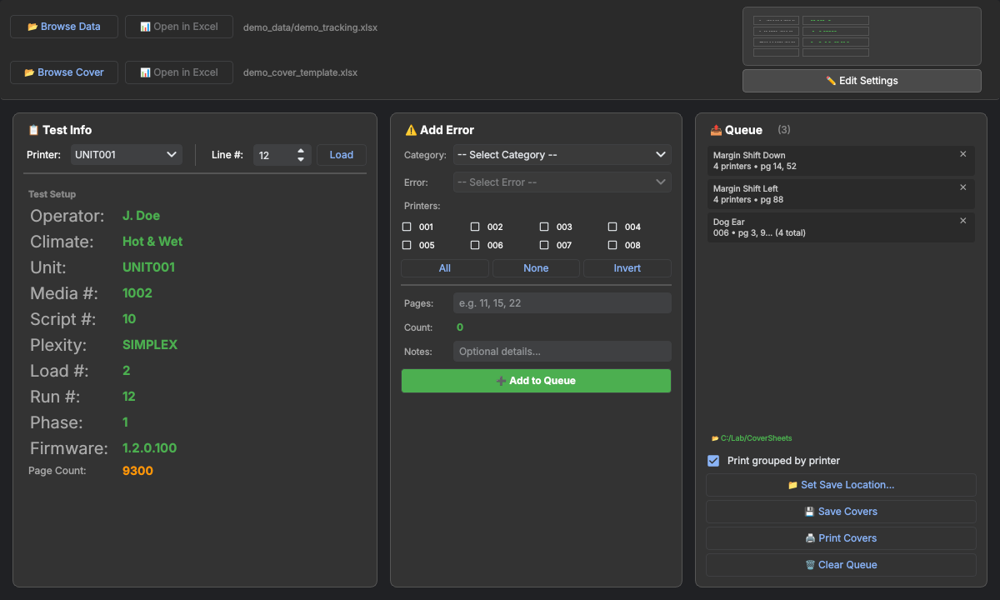
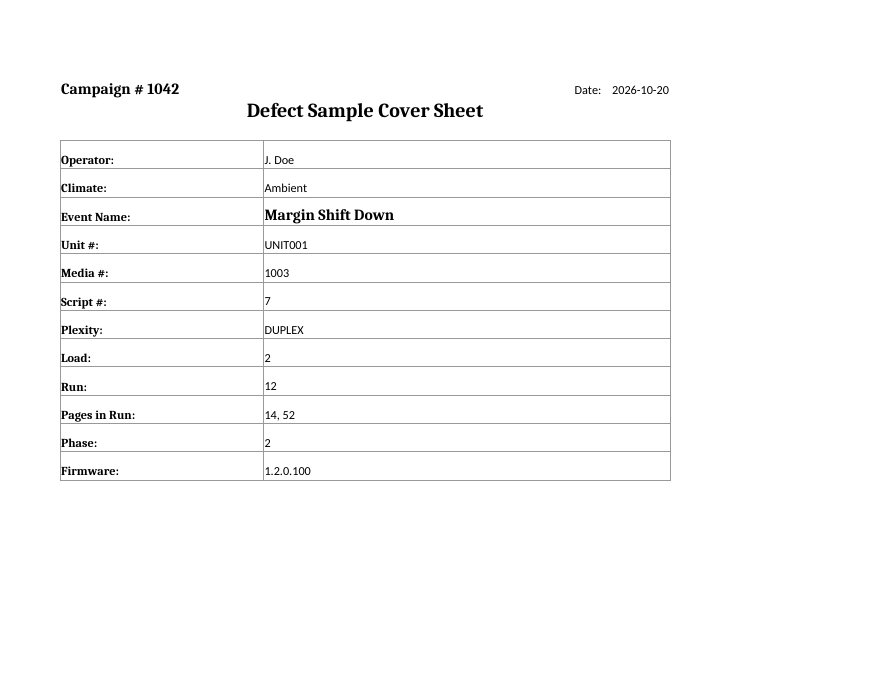

# Lab Cover Sheet Tool

A Windows desktop app for a printer reliability test lab. Technicians log print defects against a test run, and the app prints a matching cover sheet for each physical defect sample.



> All data, unit names and numbers in this repository are fictional demo data.

## The problem

During a long print test, every defective page (a jam, a smear, a margin shift) gets pulled and filed with a cover sheet. That sheet records the unit, run, media, firmware, climate and affected pages. Filling these sheets in by hand meant:

- looking up each run's test parameters in a large Excel tracking workbook (one sheet per unit, thousands of rows),
- retyping them onto a template for every defect on every unit,
- sorting the printed covers back into per-unit stacks afterwards.

## What it does

- **Loads the lab's tracking workbook** and shows the test setup (climate, media, script, plexity, load, run, phase, firmware) for any unit and line.
- **Reads defect categories from the workbook itself**, so adding a new error type to the spreadsheet makes it appear in the app without a code change.
- **Queues defects** across one or many units with page numbers. Any queued item can be removed individually.
- **Generates and prints cover sheets** by filling an Excel template and printing it through Microsoft Excel. It can also save the sheets as files.
- **Prints grouped by unit** as an option, so each unit's covers come out together and nothing needs re-sorting.
- **Remembers session settings** (operator, campaign, firmware, phase) between runs and keeps a rotating debug log.



## Technical highlights

- **PyQt6** UI split into reusable widgets (`app/widgets/`), a data model (`app/models/`) and a print/generation service (`app/services/`).
- **pandas + openpyxl** for reading a ~25 MB, multi-sheet workbook. The app reads only the cells it needs, caches each sheet, and never holds the file open, so Excel can keep editing and saving it while the app runs.
- **Excel COM automation (pywin32)** for printing. The app attaches to a running Excel or starts a hidden one, and always cleans up, so a failed print never leaves a stray `EXCEL.EXE`. It also supports AppleScript printing on macOS.
- **Partial-failure handling:** printing is tracked per sheet, and only the sheets that failed stay in the queue for retry.
- **Hardening:**
  - Text written to cover sheets is always stored as text, preventing Excel formula injection.
  - Workbooks are parsed with `defusedxml`.
  - Output file names are sanitised for Windows.
  - Only spreadsheet files can be opened from the app.
- **CI/CD:** a GitHub Actions workflow builds a standalone Windows `.exe` with PyInstaller on every push to `main`.

## Try it

Requires **Python 3.10 or 3.11** (the `pyqtdarktheme` dependency does not support 3.12+). Printing needs Windows with Microsoft Excel. Everything else, including saving cover sheets, works on any OS.

```bash
python -m venv venv
venv\Scripts\activate          # macOS/Linux: source venv/bin/activate
python -m pip install -r requirements.txt
python main.py
```

Then:
1. Click **Browse Data** and pick `demo_data/demo_tracking.xlsx`.
2. Click **Browse Cover** and pick `demo_data/demo_cover_template.xlsx`.
3. Choose a unit and line, then add a defect with a category, units and pages.
4. **Set Save Location…** then **Save Covers**, or **Print Covers** on Windows.

To regenerate the demo workbooks, run `python tools/make_demo_data.py`.

### Windows executable
Run `build.bat`, or download the `LabCoverSheet` artifact from the latest **Build Windows Executable** run in the Actions tab.

## Project layout

```
main.py                     entry point
app/
  main_window.py            window, file loading, save/print orchestration
  constants.py              units, layout constants, test-info field mapping
  models/error_entry.py     queued defect data model
  services/cover_sheet_service.py   template filling, Excel/macOS printing
  utils/                    config persistence, logging, file helpers
  widgets/                  test info, add-defect, queue, settings dialog
demo_data/                  fictional tracking workbook and cover template
tools/make_demo_data.py     generates the demo workbooks
```

## Author

Kelly St.Onge
